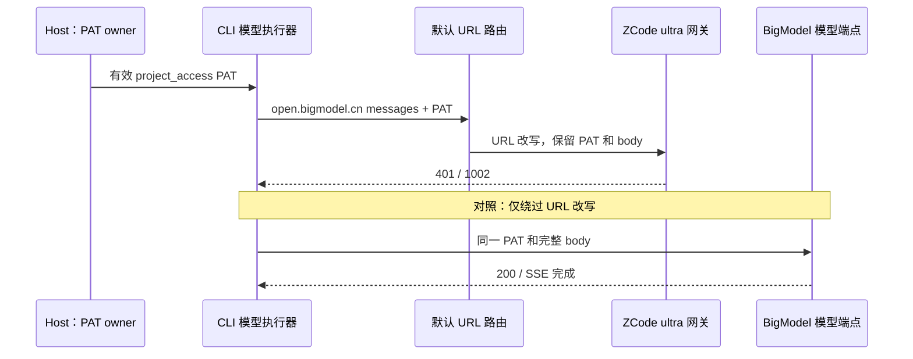
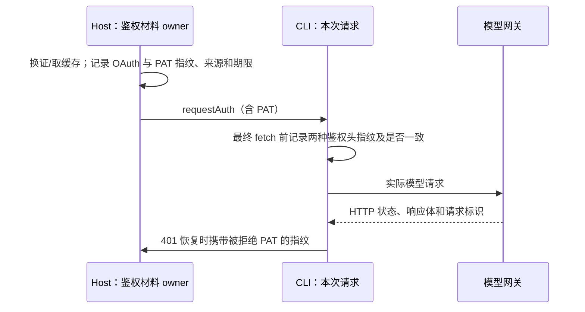

# ZetaCode Coding Plan 401：根因确认

核查日期：2026-10-11，Asia/Shanghai。范围为当前源码、官方与 fork 的已安装包、运行进程、已有日志及小规模真实 API 对照请求。调查阶段未修改业务代码、登录状态、配置或已安装包，未重启运行中的桌面应用。用户随后授权源码修复，结果见文末。

## 当前结论

**已确认：fork 的默认 endpoint routing 把 BigModel 模型请求改写到 ZCode `/api/v1/ultra/anthropic/v1/messages`。当前 PAT 和请求头组合被这个网关拒绝，但同一 PAT、同一完整 body 直连 BigModel 成功。**

22:47 前已在原失败 CLI（PID 77276，未重启）完成真实进程对照。临时关闭 URL 改写后，进程自身的 GLM-5.3 连通性探测从 401 变成 200。诊断后已恢复原路由、撤销观察钩子、清除诊断全局引用并关闭 inspector。后续已实施源码修复并重新构建桌面 Agent；当前已安装的旧包尚未更新。

本次根因不需要以产品改名、设备指纹、SSE 或凭证缓存失效解释。ZCode → ZetaCode 的展示名称变更不是已证实的直接原因。

## 对原报告的四项修正

1. **两个已安装版本的鉴权实现并不相同。** 官方 `C:/Program Files/ZCode/resources/app.asar` 的 Host 使用 `AccountProviderApiKeyResolver.resolveBizApiKey`，调用 `/copy/{apiKeyId}` 读取 `secretKey`，组合长期 Key 并保存缓存。扫描其全部 `out/host/*.js` 没有发现 `/access_tokens` 调用。fork 的 Host 则明确调用 `/access_tokens`，返回 PAT。不能以官方的长期 Key 请求成功证明 fork 的 PAT 请求等价。
2. **fork 换证的实际 `clientVersion` 是 `3.15.1`。** 已安装 Host 的 `chunk-2VUNXGGD.js` 中，换证请求引用 `$g`，其值为 `3.15.1`，构建 commit 为 `651bb077`。此前手工复现使用的 `0.16.9` 并非这个请求体的实际版本。两种版本已分别补测，均成功。
3. **调查时 fork 仍在运行。** 主进程 PID 68004、Host PID 64976 的创建时间仍为 21:25，后续持续输出内存日志。22:11 不能据此认定为进程退出时间，也没有完成“退出后重启”的对照。
4. **“fork 未接线 endpoint routing”不成立。** `zcode-protocol-entrypoint.ts:193` 默认创建路由端口，`:307` 注入 app，`create-app.ts:567` 注入模型执行器。运行时也实际存在该端口，并将 BigModel URL 改写到 ZCode 网关。模型日志中的配置 baseURL 不能证明最终网络 URL。

## 决定性证据

通过原失败 CLI 的本地 Node inspector，调用既有 `testModelConnectivity`，在 Host → CLI 鉴权返回边界和最终网络 transport 边界观察请求。提示词是探测用的 `hi`，未重放用户会话。

| 对照 | 实际目标 | 结果 |
| --- | --- | --- |
| 原失败进程正常路由，attempt 1 | ZCode `/api/v1/ultra/anthropic/v1/messages` | 401，type 1002 |
| 同进程恢复鉴权后，attempt 2 | 同一 ZCode 网关 | 401，type 1002 |
| 捕获完整请求，保留全部请求头/body，仅替换目标 URL | BigModel `/api/anthropic/v1/messages` | 200，SSE message_start/message_stop 完整 |
| 同一 runtime 暂时关闭地址改写，再调用自身连通性探测 | 同一 BigModel 端点 | 200，探测成功 |

失败响应体：

```json
{"error":{"message":"Authorization Token非法，请确认Authorization Token正确传递。","type":"1002"}}
```

两次失败和成功探测的鉴权与 body 证据相同：

- Host 返回的 PAT、最终 `x-api-key`、去掉 Bearer 前缀的 `Authorization` 均为同一 SHA-256：`42d20e4215d2e32f1fa68b55c423a0e299b43c4652aa6980ea27ddbb66a76737`，长度 459。
- JWT `client_version=3.15.1`、`token_use=project_access`；刷新后返回同一 PAT。
- body 为 410 字节，SHA-256：`fbc4798ced1da7f922207dbb76287ece65154cd7f27dd2ff315b9068fc1cadcf`。
- body 字段包含 `model/max_tokens/metadata/system/messages/stream/thinking/output_config`。这次已经覆盖真实模型执行器生成的 SSE 和 thinking 配置。

因此手工复现与 app 并非同一条实际请求链路。PAT 没有在 Host → CLI → fetch 中被替换，差异在最终目的地。

## 代码原因与修复边界

`apps/zcode-cli/packages/adapters/src/model/endpoint-routing-edition/index.ts:8` 返回静态官方网关路由。`official-coding-plan-gateway.ts:9` 定义 BigModel → `/api/v1/ultra/anthropic/v1/messages` 的映射，`:33` 使用 ZCode origin 构造目标地址。公共 `provider-endpoint-routing-fetch.ts:34` 将改写 URL 交给网络层，鉴权与请求体保留。



`aac47556`（升级 v3.15.1）引入当前 edition 路由工厂和默认 bootstrap 接线；官方网关映射在更早基线已存在，不能说这次升级首次引入网关这个概念。已检查的品牌改名提交没有造成这个鉴权目的地差异。

可验证的 fork 修复方向是让 PAT 请求使用匹配的 BigModel 端点，调整 fork 的路由策略和对应验收场景；当前临时对照已经证明这样能消除此 401。不能靠重登、反复刷新同一个 PAT 或恢复展示名修复。

仅凭客户端证据无法断言 ZCode 服务端究竟不支持该 PAT、要求不同鉴权材料，还是另有网关校验要求；能够确认的是当前请求组合在该网关被拒绝，而在 BigModel 被接受。这一服务端细节不影响上述客户端原因与直连对照结果。

## 改名与鉴权的关系

`fa27a54f` 的主要变化是 productName、appId、Electron app name、系统集成及界面文案。OAuth 使用的 `zcode://` 协议保留。

`59044c0f`、`651bb077` 改变全局数据根目录为 `.zetacode`，可能间接改变读取的凭证、设置与设备标识，这是仍需留意的状态边界。

当前换证与模型链路保留了以下名称：

- 换证 `clientType: "zcode"`。
- API Key 查找名称 `zcode-api-key`。
- 默认模型请求 User-Agent 的 `ZCode/` 前缀。
- 凭证加密 fallback 的 `zcode-credential-fallback:` 前缀。

未发现这些鉴权相关字符串被品牌替换。凭证加密实现与初始开源基线没有相关改名差异，独立诊断也能解密 fork 当前凭证。

## 已执行的对照

诊断代码只在内存中读取 OAuth 与 PAT，输出状态、字段名及 PAT SHA-256。请求使用人工构造的短提示词，不重放用户会话正文。

| 换证版本 | 模型请求条件 | 结果 |
| --- | --- | --- |
| 0.16.9 | 仅 x-api-key，非流式 | 200 |
| 0.16.9 | x-api-key + Bearer Authorization，非流式 | 200 |
| 0.16.9 | 仅 x-api-key，SSE | 200 |
| 0.16.9 | 双鉴权头，SSE | 200 |
| 0.16.9 | 双鉴权头，SSE，system/tools | 200 |
| 0.16.9 | 客户端来源头组合，以及 User-Agent、App-Version、Title、Agent 的单独对照 | 全部 200 |
| 3.15.1 | 上述五种基本鉴权、流式及 system/tools 条件 | 全部 200 |
| 3.15.1 | 来源头 + 请求/会话/trace/query 归因头组合 | 200 |
| 3.15.1 | trace、query-source、人工 device-mid 的单独对照 | 全部 200 |
| 3.15.1 | prompt-caching/interleaved-thinking 的 anthropic-beta 头 | 200 |
| 0.16.9 | fork 已安装 AiSdkModelExecution，独立 Node 进程 | 200，SSE 读完 |
| 3.15.1 | fork 已安装 AiSdkModelExecution，ZetaCode 自带 Electron/Node | 200，SSE 读完 |

最后两项在内存中载入安装包的模型执行模块，跳过 CLI 启动入口，再正常调用模型绑定与请求方法；没有改写磁盘上的安装包。传输边界验证 `x-api-key` 等于所传 PAT、`Authorization` 等于 `Bearer PAT`，实际 URL 为 `/api/anthropic/v1/messages`。

上表是早期独立进程对照。随后新增了前述真实失败进程观测，已取得 Host PAT 指纹与完整探测 body；仍未重放历史用户会话正文及全部工具定义。

## PAT 与请求签名的新证据

PAT 为 JWT，字段包括 `iss/sub/aud/jti/iat/exp/api_key/client_type/client_version/token_use`；未见单独的 capability/scope 字段。3.15.1 样本的 `token_use` 为 `project_access`。

按 3.15.1 换证，多次返回同一 SHA-256，JWT `iat` 为 20:58:05。按 0.16.9 换证的另一枚 PAT，`iat` 为 22:02:34。**再次调用换证接口不保证得到不同 PAT**；客户端“刷新过”不能单独证明服务端签发了新一代凭据。两枚 PAT 在本次对照中均可用。

官方已安装 CLI 含请求签名逻辑，fork 的 `request-security-edition` 是空实现。这个安装包差异真实存在，但 BigModel 直连对照无需签名即可成功；不能把签名差异进一步认定为 ZCode 服务端拒绝的具体规则。

## 诊断方法说明（已完成）

本次已在同一个真实失败 attempt 内关联鉴权返回、最终网络发送和响应三个边界：



原先计划收集以下观测：

- Host 实际凭证文件路径、OAuth 指纹、PAT 指纹、cache/issue 来源、JWT iat/exp/client_version，以及刷新前后指纹是否改变。
- 最终网络边界的 URL、鉴权头数量、PAT 指纹、Bearer 去前缀后的指纹、body 哈希、stream 值及 body 字段名。
- 401 的有限长度脱敏响应体、Content-Type、上游请求标识。

原有日志和数据库未提供这组证据；本次通过实际进程边界观察补齐了决定性的 PAT 一致性、真实目标 URL 和 401 响应体，随后完成仅改变路由的成功对照。

## 诊断材料与验证范围

本次可复用探针：`C:/Users/hubz/AppData/Local/Temp/zetacode-auth-probe-20261011.cjs`。

源码与安装包调查、真实失败进程探测请求捕获、完整请求重放、同进程关闭路由对照和 SSE 消费均已执行。诊断钩子已清理，原进程路由已恢复。调查阶段未改业务代码，修复阶段的检查结果如下。

## 源码修复与产物验证

用户授权后先新增 `specs/fork-model-endpoint-routing.md`，再新增失败回归用例：旧默认工厂把 BigModel 请求改写到 ultra，测试失败；修改 `endpoint-routing-edition/index.ts` 后，该工厂返回直连决策，回归通过。公共接口、进程级端口复用、显式路由能力和 PAT 换证/刷新均保留。

- adapters 相关 4 个测试文件：25 个测试通过；bootstrap 路由测试：5 个测试通过。
- `pnpm typecheck`、adapters `typecheck` 和 `build` 通过。
- `pnpm lint`：0 errors，66 warnings；本次 3 个源码/测试文件另用 CLI 工具检查，0 warnings/errors。根 lint 的 ignore 范围不覆盖这些 CLI 文件，因此不能只依赖根结果。
- 修改文件格式检查、`git diff --check` 和 `pnpm architecture:check --changed` 通过，架构违规为 0。
- `node scripts/build-desktop-agent-cli.mjs` 成功，修复产物暂存于 `packages/desktop/bundled-agents/win32-x64/glm/zcode.cjs`。
- 使用 ZetaCode 自带 Electron/Node，在内存中加载该新产物的模型执行器及默认路由工厂，使用当前 OAuth 按 3.15.1 换到 PAT：最终 URL 为 BigModel messages，两种鉴权头均与 PAT 一致，GLM-5.3 返回 200，SSE 消费完成（37 chunks）。没有修改已安装 bundle 或启动用户会话。

源码和桌面 Agent 产物已修复；`D:/Program Files/ZetaCode` 中原安装包仍为旧产物，需更新安装包后再启动才能应用修复。既有其他本地修改未恢复或纳入本次修复。

## 提交与推送检查记录

用户随后要求提交所有适合入库的改动；周额度优先重置、bootstrap import 语法修正与 Windows 本机部署文档分别提交，既有品牌和数据目录迁移提交一并推送。

第一次 `git push origin dev` 的 pre-push 钩子未通过：lint 为 0 errors / 66 warnings，架构检查为 0 违规，但 affected 单测包含文件监听恢复断言和 Windows 进程回收失败。不能将整套推送检查报告为通过。

- 单独重跑 `subagentRuntimeConfigWatcher.test.ts` 与 `zcodeAgentProcessManager.test.ts`：监听文件通过；进程管理文件 46 个测试通过、2 个失败，失败为首轮回收重试与 expanded 异常上报用例的 cleanup。
- 再单独重跑进程管理文件：46 个通过、2 个失败，失败改为 protocol close 回收与 app quit 重试。
- 两轮均在 `ZCodeStdioTransport.disposeAndWaitOnce` 报告 `runtime process tree cleanup incomplete`。日志含 Windows `taskkill` 超时或截止时仍有残留 PID；失败项随运行变化，环境时序因素尚未完成归因。
- 与 `origin/dev` 比较，`packages/services/src/process/` 与 `zcodeStdioTransport.ts` 无改动；进程管理测试仅修改了品牌数据路径及对应注释，失败用例未改动。该检查失败不属于本次 401 路由修复。

用户明确授权「允许本次跳过钩子并推送」。本次推送按此授权跳过 pre-push，保留上述失败记录；Windows 进程回收问题仍待单独处理。
