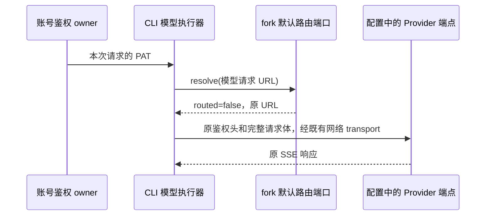

# ZetaCode 模型端点直连

## 原因与产品规则

2026-10-11 的运行进程对照确认：同一枚 BigModel project_access PAT 和完整 SSE body 经 ZCode ultra 网关返回 401/1002，直连 BigModel 返回 200。ZetaCode 默认模型请求应使用 Provider 配置的端点，不自动转发到 ZCode ultra/ultra-zai 网关。

1. fork 的 `createProviderEndpointRoutingPort` 对所有请求返回 `{ routed: false, url: requestUrl }`，保留 URL 的完整字符串，包括 query、大小写和尾部斜杠。
2. BigModel 与 Z.ai Coding Plan 都遵守上述规则；手动 API Key 和第三方 Provider 同样保持配置端点。
3. 默认策略不读取远端路由配置，不调用来源 Header 回调，不创建路由快照、timer 或新凭据缓存。
4. 继续通过既有 `ProviderEndpointRoutingPort` 和公共 fetch wrapper 装配，显式注入的路由仍按其合同执行，不删除 bootstrap、CLI、TUI、桌面 Agent、workflow/subagent 的接线。
5. PAT 仍由原有账号鉴权 owner 换取和刷新；本次只调整默认目的地，不修改 OAuth、重置卡、Provider 持久化配置或公共协议。

## 所有者与事件顺序

fork 的默认策略由 adapters `model/endpoint-routing-edition/index.ts` 持有。bootstrap 保持进程级端口复用，模型执行器仍将每次请求交给该端口。策略无可变业务状态；没有新增写入路径、owner/lease 或同步逻辑。

桌面 continuous 与手机 replayable 继续使用同一会话运行时；本次不改变 stream/snapshot/queue 的交付语义。

## 验收场景

- 默认工厂与公共 fetch 的组合对 BigModel、Z.ai 保留最终 URL、PAT 双鉴权头、method、含 thinking/tools 的 body、AbortSignal 和 SSE 响应；不得发送至 ZCode ultra 路径。
- 默认工厂不发起路由配置请求或读取来源 Header。
- bootstrap 的进程级默认端口也返回直连决策，避免只修独立模型测试而遗漏真实启动路径。
- 普通 API/第三方 URL 保持不变；既有显式路由的公共 wrapper 测试继续通过。
- 运行相关测试、`pnpm typecheck`、adapters 包类型检查、`pnpm lint`、`pnpm architecture:check --changed`。

## 交付边界

源码修复需要重新构建并安装/启动包含该代码的 CLI/桌面产物才会生效；源码修改不改变已运行的旧安装包。
